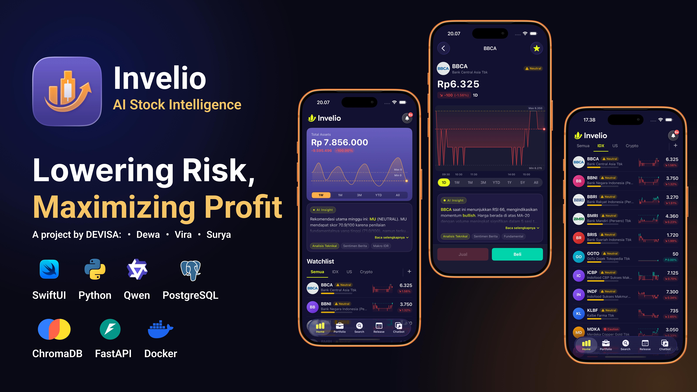

# Invelio

AI-powered stock analysis and portfolio tracking platform for the Indonesia Stock Exchange (IDX) and global markets.



## Overview

Invelio integrates real-time market data, local LLM-driven financial insights, and portfolio management into a unified system. The platform consists of a native iOS client built with SwiftUI and a Python FastAPI backend powered by local LLMs via Ollama and retrieval-augmented generation (RAG) via ChromaDB.

## Features

- Market Data & Watchlist: Real-time price tracking and search for IDX and global equities.
- AI Stock Analysis: Automated technical and fundamental evaluation via multi-agent scoring pipelines.
- Financial RAG Chatbot: Context-aware investment assistant utilizing ChromaDB embeddings and local LLMs.
- Portfolio Management: Real-time valuation, gain/loss calculation, and allocation tracking.
- Proactive Alerts: Automated anomaly detection and price movement notifications.

## Tech Stack

- Mobile Client: iOS (SwiftUI, Swift Concurrency, MVVM)
- Backend: Python, FastAPI, Uvicorn
- AI & LLM: Ollama (Qwen 2.5), LangChain, ChromaDB
- Database: PostgreSQL (Relational), ChromaDB (Vector Store)
- Infrastructure: Docker, Docker Compose

## Repository Structure

- `backend/`: FastAPI application, multi-agent systems, and RAG pipelines.
- `SahamIndo/`: Native iOS client application built with SwiftUI.
- `docker-compose.yml`: Container definitions for PostgreSQL and ChromaDB.
- `start.sh`: Bootstrap script for services and backend runtime.

## Getting Started

### Prerequisites

- macOS with Xcode 15+ (for iOS development)
- Python 3.10+
- Docker and Docker Compose
- Ollama

### Backend Setup

1. Start database services:
   ```bash
   docker compose up -d
   ```

2. Set up Python environment:
   ```bash
   python3 -m venv venv
   source venv/bin/activate
   pip install -r requirements.txt
   cp .env.example .env
   ```

3. Initialize the database schema:
   ```bash
   python -m backend.db.init_db
   ```

4. Pull the local LLM model:
   ```bash
   ollama pull qwen2.5:3b
   ```

5. Run the backend server:
   ```bash
   ./start.sh
   ```

The API will be accessible at `http://localhost:8080`. Interactive documentation is available at `http://localhost:8080/docs`.

### iOS Client Setup

1. Open `SahamIndo/SahamIndo.xcodeproj` in Xcode.
2. In `SahamIndo/Core/Data/Network/APIClient.swift`, verify that the backend host IP matches your local environment.
3. Select a target simulator or physical device and run the project.

## Environment Variables

| Variable | Description | Default |
| --- | --- | --- |
| `POSTGRES_HOST` | PostgreSQL host | `localhost` |
| `POSTGRES_PORT` | PostgreSQL port | `5432` |
| `POSTGRES_DB` | Database name | `saham_db` |
| `CHROMA_HOST` | ChromaDB host | `localhost` |
| `CHROMA_PORT` | ChromaDB port | `8000` |
| `OLLAMA_BASE_URL` | Ollama API endpoint | `http://localhost:11434` |

## Disclaimer

This project is for educational and informational purposes only. It does not constitute financial, investment, or legal advice.
